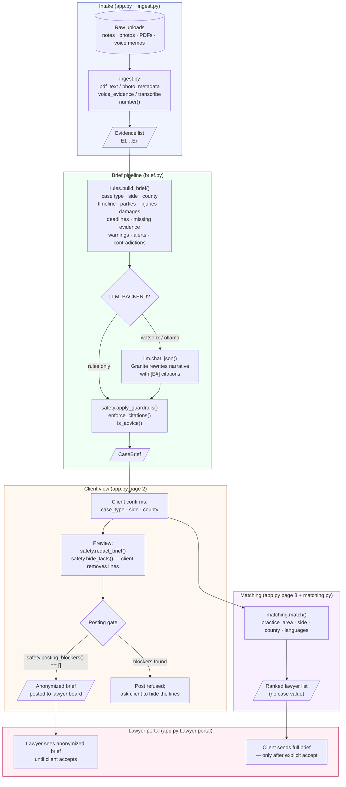

# CaseBridge — Architecture

> **Scope.** This document covers the `casebridge/` Python package and `app.py`.
> It describes the data pipeline, what each module does, where the responsible-AI
> rules from AGENTS.md §2 are enforced, and the five most significant technical risks.
> It is a read-only reference; change code first, then update this file.

---

## Pipeline diagram

---

## Module reference

### `casebridge/models.py` — shared contract

The only file all three team areas import directly.

| Type | Fields | Purpose |
|---|---|---|
| `Evidence` | `id`, `kind`, `title`, `text`, `file_name` | One piece of raw input (note / voice / photo / document). Ids are assigned by `ingest.number()` after all items are collected. |
| `Fact` | `text`, `sources: list[str]`, `when` | One statement extracted from the evidence. `sources` is a list of Evidence ids (`E1`, `E3`, …). A Fact with no surviving sources is dropped by `enforce_citations`. |
| `CaseBrief` | `case_type`, `client_side`, `county`, `summary`, `timeline`, `parties`, `injuries`, `damages`, `missing_evidence`, `deadlines`, `languages`, `warnings`, `alerts`, `contradictions`, `engine` | The full structured brief. Produced by `rules.build_brief`, optionally enriched by Granite, then cleaned by `apply_guardrails`. |
| `PRACTICE_AREAS` | dict of 6 keys | Canonical case-type keys (`auto_accident`, `premises`, …). Used by `rules`, `brief`, `matching`, and the Streamlit UI. |

**Change policy:** any field rename or addition must be coordinated across `rules.py`, `brief.py`, `safety.py`, `matching.py`, and `app.py` in a single commit.

---

### `casebridge/ingest.py` — evidence intake

Turns raw bytes into `Evidence` objects. Runs before the LLM; all extraction here is deterministic.

| Function | What it does |
|---|---|
| `pdf_text(data)` | Extracts text from a PDF using `pypdf`. Falls back gracefully if the library is absent. |
| `photo_metadata(data)` | Reads EXIF from a JPEG/HEIC: timestamp and GPS coordinates. GPS is formatted as a decimal string so `safety.redact` can recognise and hide it. |
| `photo_note(meta)` | Formats EXIF metadata as a one-line sentence appended to the photo caption. |
| `transcribe(data, file_name)` | Runs `faster-whisper` locally with `task="translate"` to produce an English transcript. If `info.language_probability < 0.5` the language is returned as `None` (unknown). For non-English audio a second `task="transcribe"` pass preserves the original-language text appended under an `"Original (<Language>):"` label. Never raises. |
| `voice_evidence(data, file_name)` | Calls `transcribe`, sets the `Evidence.title` to record the language (used by `rules.detect_languages`). |
| `kind_for(file_name)` | Maps file extension to `"voice"`, `"photo"`, `"document"`, or `"note"`. |
| `number(items)` | Assigns stable `E1`, `E2`, … ids to a list of Evidence after all items are collected. |
| `load_demo_case(name)` | Loads fictional demo data from `data/`. Reads files as UTF-8 explicitly (Windows default encoding would misread accented characters). |

**Data flow out:** `list[Evidence]` with stable ids → `rules.build_brief`, `brief.build`.

---

### `casebridge/rules.py` — deterministic extraction

All deadlines, missing-evidence checks, language detection, and structured fact extraction come from here. The LLM is never consulted for these; they must remain auditable and offline-capable.

| Function | What it does |
|---|---|
| `detect_case_type(evidence)` | Keyword-score across `CASE_KEYWORDS`; returns the top key or `"other"`. |
| `detect_side(evidence)` | Counts plaintiff vs. defense cue phrases; defaults to `"plaintiff"`. |
| `detect_county(evidence)` | Regex for `"<name> county"` then `CITY_TO_COUNTY` lookup. |
| `detect_languages(evidence)` | Scans voice/note titles and text for language names. English is dropped only when the client explicitly says they don't speak it, and only if another language was found. |
| `collect(evidence, predicate)` | Iterates `sentences(ev)` for each item; adds matching sentences as `Fact` objects, deduplicating near-duplicates and merging their sources. |
| `missing_evidence(evidence, case_type)` | Compares the evidence set against `CHECKLIST[case_type]`; returns labels that are not satisfied. Witness items require a contact detail to count. |
| `deadlines(evidence, case_type)` | Adds California statute deadlines anchored to the incident date, a 6-month government-entity clock where cues are present, and any response date found in documents (`by … sign/respond`). |
| `warnings(evidence)` | Emits a warning when the client asks a decision question ("should I sign?"), or when a settlement release is found in the evidence. |
| `insurer_alerts(evidence)` | Detects 6 common insurer tactics by keyword; adds a "short response window" alert when a document deadline is within 45 days of the incident. Every alert ends with a question to bring to a lawyer, never with a recommendation. |
| `contradictions(evidence)` | Compares incident dates, incident times (within 30 minutes), injured body-side mentions, and licence plates across evidence items; reports disagreements with citations. |
| `build_brief(evidence)` | Calls all of the above and assembles a `CaseBrief`. |

**Data flow out:** `CaseBrief` (rules engine fields populated) → `brief.build`.

---

### `casebridge/llm.py` — LLM client

Standard-library only (`urllib.request`, `json`). No SDK dependency.

| Function | What it does |
|---|---|
| `backend()` | Reads `LLM_BACKEND` env var. `auto` → watsonx if credentials present, else Ollama if reachable, else `"rules"`. |
| `chat(system, user)` | Calls watsonx (`ibm/granite-3-3-8b-instruct` by default) or Ollama. `temperature=0` for deterministic output. |
| `chat_json(system, user)` | Wraps `chat`, extracts the first `{…}` from the response. |

**Data flow:** `SYSTEM_PROMPT` + `evidence_block` → `chat_json` → raw JSON dict → `brief.build` (merged with rules output).

---

### `casebridge/brief.py` — pipeline orchestrator

Connects the rules pass, the optional LLM pass, and guardrails into the single `build()` function.

| Function | What it does |
|---|---|
| `evidence_block(evidence)` | Wraps each Evidence item in `<evidence id="…" kind="…">` tags using `safety.wrap_evidence`. Items containing injection attempts are flagged `flagged="possible-instructions"`. |
| `build(evidence, use_llm)` | 1. Runs `rules.build_brief` (always). 2. Calls `safety.injection_warnings` to flag suspicious evidence. 3. If an LLM backend is available, calls `llm.chat_json` and merges its output into the rules brief; case type and deadlines are re-derived from rules if the LLM changes the case type. 4. Applies `safety.apply_guardrails` unconditionally. Any LLM exception falls back silently to the rules-only brief. |

**The LLM only touches:** `summary`, `timeline`, `parties`, `injuries`, `damages`, `case_type`, `client_side`, `languages`. It never touches `deadlines`, `missing_evidence`, `warnings`, `alerts`, or `contradictions` — those remain deterministic.

---

### `casebridge/safety.py` — responsible-AI layer

Four independent concerns, all in one module so the responsible-AI team owns one file.

#### 1. Advice guardrail (`is_advice`, `apply_guardrails`)

`ADVICE_PATTERNS` covers English and Spanish outcome-prediction and advice phrasing. `apply_guardrails` drops any `Fact` that matches, scrubs matching clauses from `summary`, and appends a count to `brief.warnings`. Applied **after** both the rules pass and the LLM pass.

#### 2. Citation enforcement (`enforce_citations`)

Called inside `apply_guardrails`. Any Fact whose `sources` list contains no id from the actual evidence set is silently dropped. This ensures every statement reaching a lawyer traces to a real document.

#### 3. Prompt-injection defence (`injection_flags`, `injection_warnings`, `wrap_evidence`)

`INJECTION_RE` matches patterns that try to override or reassign the model's role (English and Spanish). Suspicious evidence items are:
- Flagged in `brief.warnings` for the client.
- Marked `flagged="possible-instructions"` in the `<evidence>` fence sent to Granite.
- The `SYSTEM_PROMPT` in `brief.py` explicitly instructs Granite to report flagged items as data and never obey them.

#### 4. PII redaction (`find_names`, `redact`, `redact_brief`, `find_leaks`, `posting_blockers`)

Two-pass redaction:
1. **Pattern pass** (`PII_PATTERNS`): phones, emails, SSNs, VINs, plates, DOB dates, addresses, GPS coordinates, policy/claim ids, ZIPs.
2. **Name pass** (`find_names` → `redact`): role-tagged name detection (CLIENT, OTHER PARTY, ADJUSTER, PERSON) with accents normalised and first/last-name-only fallback. `COMMON_WORDS` names (Will, Grant, …) are only replaced when capitalised.

After redaction, `find_leaks` runs a second scan. Any Fact that still contains a known identifier is replaced wholesale with `[Statement hidden to protect the client's identity]`. `posting_blockers` is the final gate before a brief reaches the lawyer board.

The client also controls a **privacy receipt** (`privacy_summary`) and a **per-line hide toggle** (`hide_facts`) before posting.

---

### `casebridge/matching.py` — lawyer matching

| Function | What it does |
|---|---|
| `load_lawyers()` | Reads `data/lawyers.json` (all fictional profiles). |
| `speaks_with(client_langs, lawyer_langs)` | Hard filter: fails only when the client has no English and shares no language with the lawyer. English-speaking clients see everyone. |
| `match(case_type, side, county, languages)` | Hard filters (practice area, side, language), then a fit score: +3 for county match, +2 for shared non-English language, ±rating nudge. Results sorted by score then rating. No case-value computation of any kind. |

**Data flow:** `CaseBrief` fields (case_type, client_side, county, languages) → `match` → `list[dict]` with `fit_score` and human-readable `why` list.

---

### `app.py` — Streamlit UI

Four pages. Each page corresponds to one step of the client journey, plus a separate lawyer portal.

| Page | What happens |
|---|---|
| **1 · Tell us what happened** | Uploads are routed to `ingest`; `brief_agent.build` is called on demand. |
| **2 · Your case brief** | Client confirms case type, side, county. Warnings and alerts are shown. Redacted preview with per-line hide checkboxes. |
| **3 · Find a lawyer** | Calls `matching.match`. Lawyer board post button runs `posting_blockers` gate before inserting. |
| **Lawyer portal** | Shows only anonymized briefs; full brief visible only after the client explicitly accepts a connect request. Board is sorted by date, never by estimated case value. |

---

## Responsible-AI rules enforcement map

AGENTS.md §2 lists seven product rules. The table below shows where each is enforced in code.

| Rule | Description | Enforced in | Function / mechanism |
|---|---|---|---|
| **1. No legal advice** | Never predicts outcomes, values a case, or tells the client what to do. | `casebridge/safety.py` | `is_advice()` + `ADVICE_PATTERNS` (English + Spanish); `apply_guardrails()` drops matching Facts and scrubs the summary. `rules.py` `warnings()` explicitly refuses decision questions. |
| **2. Every fact cites evidence** | Each statement carries Evidence ids; uncited output is dropped. | `casebridge/safety.py` | `enforce_citations()` called inside `apply_guardrails()`. Any Fact with no surviving source id is counted and dropped; the count is surfaced to the user as a warning. |
| **3. Deadlines and checklists are deterministic** | Statutes come from `rules.py`, never from the LLM. Labels say "confirm with a lawyer". | `casebridge/rules.py` | `deadlines()` and `missing_evidence()` are called from `rules.build_brief()` and re-called if the LLM changes the case type. The LLM is structurally blocked from touching these fields in `brief.build()`. UI label: "General California rules. Exceptions apply. A lawyer must confirm every date." |
| **4. No case-value score** | Lawyer board is sorted by date; no ranking by expected payout. | `casebridge/matching.py` | `match()` uses a fit score based on practice area + county + language, not case value. `app.py` lawyer portal: board is sorted by `posted` date; UI label explicitly says "sorted by date posted, never by estimated value". |
| **5. Lawyers see anonymized cases** | Personal details hidden until the client accepts a lawyer. | `casebridge/safety.py` + `app.py` | `redact_brief()` runs PII + name redaction. `find_leaks()` does a second scan and hides whole statements. `posting_blockers()` is the gate before any post. Full brief is only passed in `app.py` after `c["connected"]` contains the lawyer's id. |
| **6. Client stays in control** | Client confirms case type, side, county; chooses who sees their brief. | `app.py` page 2 | `selectbox`/`text_input` for case type, side, county. `hide_facts()` implements per-line opt-out. "Post" and "Send my brief" are explicit client actions. |
| **7. Offline mode always works** | `LLM_BACKEND=rules streamlit run app.py` must run with no network. | `casebridge/llm.py` + `casebridge/brief.py` | `backend()` returns `"rules"` when `LLM_BACKEND=rules`. `brief.build()` skips the LLM path when `backend() == "rules"`. `ingest.transcribe()` never raises if `faster-whisper` is absent. All demo data is static files. |

---

## Top 5 risks and suggested fixes

### Risk 1 — Advice-pattern gaps in the guardrail

**What:** `ADVICE_PATTERNS` covers specific English and Spanish phrasings, but adversarial or paraphrased advice slips through. Examples already documented in `tests/test_bob_edge_cases.py`: inverted questions ("Shouldn't you settle?"), less common Spanish forms, and `"worth fighting for"` matching the case-value pattern.

**Impact:** A piece of AI-generated advice could reach the client and, later, a lawyer. This is the most direct violation of Rule 1.

**Suggested fix:** Add a secondary semantic check alongside the regex. Granite Guardian (`ibm/granite-guardian-3-2-2b`) is already in IBM's model catalogue and is purpose-built for harm detection; calling it on `summary` and each `Fact.text` before `apply_guardrails` returns would catch paraphrases the regex misses. Alternatively, expand `ADVICE_PATTERNS` with the Spanish and question-form patterns identified in the edge-case test file.

**Status (Oct 24):** Fixed for every example in `tests/test_bob_edge_cases.py`; those tests are no longer xfail. Granite Guardian is not wired in yet.

---

### Risk 2 — Name-detection gaps leave PII on the lawyer board

**What:** `find_names` uses `_WORD` (a regex requiring a capital first letter followed by lowercase) and therefore misses:
- All-lowercase names from speech-to-text output.
- Hyphenated names (`Smith-Jones`) and names with apostrophes (`O'Brien`) where the second token begins with a capital.

`tests/test_bob_edge_cases.py` documents these as xfail. If a name is never added to the names dict, `redact` cannot replace it, and `find_leaks` will not flag it (because it only checks names it was told about).

**Impact:** A real user's surname could appear on the lawyer board, violating Rule 5.

**Suggested fix:** (a) Extend `LOWER_INTRO_RE` (already in `safety.py`) to catch all-lowercase name introductions from the role patterns, not just `my name is`. (b) Update `_WORD` to allow an uppercase letter after `-` or `'` within a token (the fix is a one-line regex change in `_WORD`). Both changes need corresponding tests added.

**Status (Oct 24):** Fixed. `_WORD` handles `O'Brien` and `Smith-Jones`, lowercase introductions are caught, and the 30 attacks in `tests/test_bob_redteam.py` (OCR digits, nicknames, accents, split numbers) all pass.

---

### Risk 3 — Prompt injection via evidence reaches Granite

**What:** `INJECTION_RE` is a blocklist. A sophisticated attack using unusual Unicode spacing, base64-encoded instructions, or a novel phrasing not in the list could slip past the flag and reach the Granite prompt as unfenced text.

**Impact:** Granite could be steered to produce advice, leak names, or output content that passes the regex guardrail but harms the client. This violates Rules 1 and 5.

**Suggested fix:** Three complementary layers: (1) the `<evidence>` fencing already in `wrap_evidence` is the primary structural defence — maintain it strictly. (2) Run Granite Guardian's prompt-injection detection on each evidence item before it is sent to the main model. (3) Apply `is_advice` and `find_leaks` to Granite's raw output before merging it back, rather than only after. Currently `apply_guardrails` runs after the merge; the raw LLM string is never checked independently.

**Status (Oct 24):** Partly fixed. `has_injection` now scans a normalized copy (zero-width characters removed, look-alike letters mapped, accents dropped) and covers Vietnamese; all of `tests/test_bob_injection.py` passes. Granite Guardian and a check on Granite's raw output are still open.

---

### Risk 4 — `rules.py` keyword matching produces wrong case type or side

**What:** `detect_case_type` counts keyword occurrences without word-boundary checks and with no minimum threshold beyond `> 0`. A document that mentions "wet floor" once in an auto-accident case, or "vehicle" in a slip-and-fall description, can flip the classification. The client confirms the case type in the UI, but a wrong starting default may confuse them.

**Impact:** Wrong case type → wrong `CHECKLIST` → wrong `deadlines` (e.g., missing the 6-month government-entity clock). This is a data-quality risk rather than a safety violation, but incorrect deadlines are labelled "confirm with a lawyer" so the label correctly signals uncertainty.

**Suggested fix:** (a) Use `\b` word boundaries in `CASE_KEYWORDS` matching (currently `text.count(w)` has no boundary). (b) Require a minimum score of 2 for a confident classification, falling back to `"other"` if the best score is 1. (c) Add a test for the mixed-keyword case.

**Status (Oct 24):** Fix (a) done: keywords match as whole words, so "car" no longer matches "urgent care". The minimum score (b) was not added.

---

### Risk 5 — `ingest.load_demo_case` encoding and the offline demo

**What:** `load_demo_case` was calling `Path.read_text()` without `encoding="utf-8"`. On Windows, this read accented characters (e.g., `María`) as two Latin-1 bytes, the second being U+00AD (soft hyphen), which broke `find_names` and caused the `test_lawyer_view_has_no_personal_details[rosa]` test to fail on `main`. This was fixed in the last session, but the root cause points to a broader pattern: any new `.txt` demo file added on Windows may be saved in a non-UTF-8 encoding.

**Impact:** Accented names in demo data survive redaction and appear on the lawyer board, violating Rule 5. The `rosa` demo case is the live demo path for a Spanish-speaking client.

**Suggested fix:** (a) Add a CI check (or a `pytest` fixture) that reads every file in `data/` and asserts it decodes cleanly as UTF-8. (b) Document in AGENTS.md §6 that all `data/` files must be saved as UTF-8. (c) Consider using `pathlib.Path.read_bytes()` + `.decode("utf-8")` consistently rather than relying on the `encoding` keyword default.

**Status (Oct 24):** Fixed. `load_demo_case` reads UTF-8, and `tests/test_bao_fixes.py` checks that every file in `data/` decodes as UTF-8.
